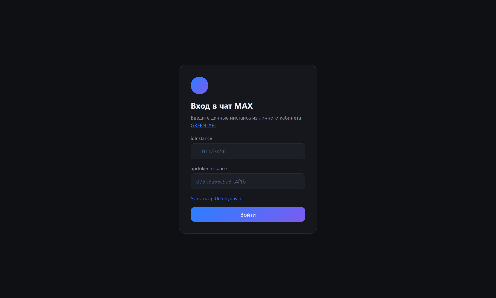
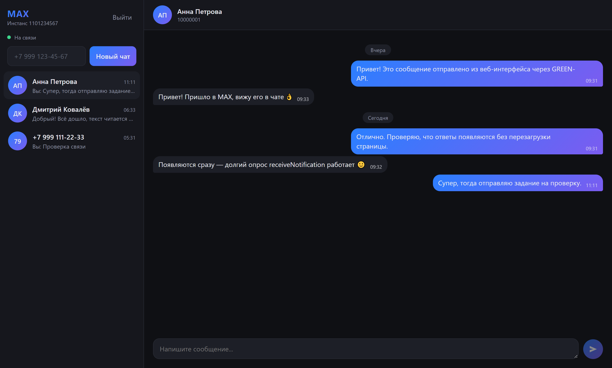
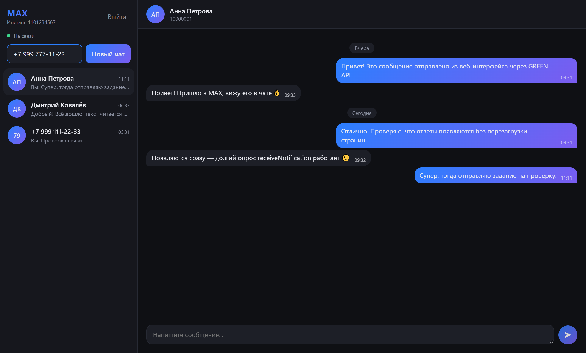
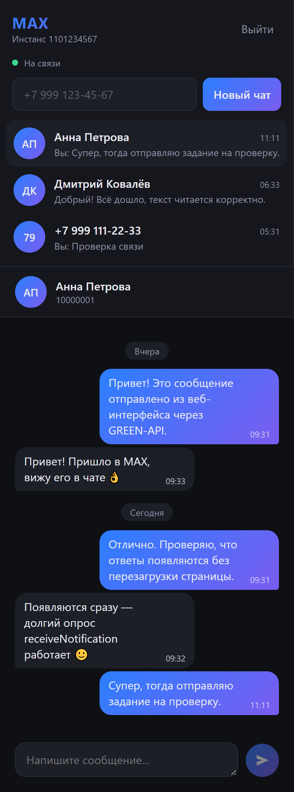

# MAX Chat — отправка и получение сообщений через GREEN-API

Веб-интерфейс чата для мессенджера **MAX**, работающий поверх [GREEN-API](https://green-api.com/max).
Пользователь вводит данные своего инстанса, создаёт чат по номеру телефона, отправляет
текстовые сообщения и видит ответы собеседника.

Тестовое задание на позицию «Фронтенд разработчик React».

**Демо:** https://USERNAME.github.io/REPO/ — подставьте свои логин и имя репозитория после
первого деплоя.

## Скриншоты

| Вход | Переписка |
| --- | --- |
|  |  |

| Создание чата по номеру | Мобильная вёрстка |
| --- | --- |
|  |  |

Скриншоты сняты на демонстрационных данных.

## Возможности

- вход по `idInstance` и `apiTokenInstance` (данные сохраняются в `localStorage`);
- создание чата по номеру телефона — `chatId` уточняется методом `CheckAccount`;
- отправка текстовых сообщений — метод [`SendMessage`](https://green-api.com/v3/docs/api/sending/SendMessage/);
- получение входящих сообщений по технологии [HTTP API](https://green-api.com/v3/docs/api/receiving/technology-http-api/):
  long polling через `ReceiveNotification` с подтверждением `DeleteNotification`;
- список чатов с превью последнего сообщения, история сообщений сохраняется локально;
- индикатор связи с API и понятные сообщения об ошибках.

Согласно заданию поддерживаются **только текстовые** сообщения, интерфейс повторяет
внешний вид [web.max.ru](https://web.max.ru/).

## Стек

React 19 · TypeScript · Vite · нативный `fetch` без сторонних библиотек.

## Что нужно для запуска

1. **Node.js 20.19+ или 22.12+** и npm.
2. Аккаунт в [console.green-api.com](https://console.green-api.com) с созданным инстансом
   для **MAX** и авторизованным аккаунтом мессенджера.
3. В настройках инстанса (вкладка «Настройки инстанса» или метод `SetSettings`):
   - `webhookUrl` — **пустой** (иначе уведомления уйдут на вебхук, а не в очередь);
   - `incomingWebhook` — `yes`;
   - `outgoingWebhook` — `yes` (чтобы в интерфейсе появлялись сообщения, отправленные
     с телефона).

## Локальный запуск

```bash
npm install
npm run dev
```

Приложение откроется на <http://localhost:5173>. На экране входа введите `idInstance` и
`apiTokenInstance` из личного кабинета GREEN-API.

Хост API подбирается автоматически (`https://<первые 4 цифры idInstance>.api.green-api.com`,
при недоступности — `https://api.green-api.com`). Если в личном кабинете указан другой
адрес, его можно задать вручную по ссылке «Указать apiUrl вручную» на экране входа.

### Сборка production-версии

```bash
npm run build
npm run preview
```

### Проверки

```bash
npm run lint   # oxlint
npx tsc -b     # проверка типов
```

## Как пользоваться

1. Войдите, указав данные инстанса.
2. В левой колонке введите номер телефона получателя (коды `7` и `375`) и нажмите
   «Новый чат».
3. Напишите сообщение и отправьте его — `Enter` отправляет, `Shift + Enter` переносит строку.
4. Ответ получателя появится в чате автоматически, без перезагрузки страницы.

## Структура проекта

```
src/
  api/
    greenApi.ts      HTTP-клиент GREEN-API (SendMessage, ReceiveNotification, ...)
    types.ts         типы запросов и уведомлений API
  components/
    LoginForm.tsx    экран ввода idInstance / apiTokenInstance
    ChatApp.tsx      каркас: список чатов + окно переписки
    Sidebar.tsx      список чатов и создание чата по номеру
    ChatWindow.tsx   шапка чата, история и поле ввода
    MessageList.tsx  лента сообщений с разделителями по дням
  hooks/
    useChat.ts       состояние чатов, цикл приёма уведомлений, отправка
  utils/             телефоны, форматирование, localStorage
  types.ts           доменные типы (Chat, Message)
```

## Как это работает

**Отправка.** `POST {apiUrl}/waInstance{id}/sendMessage/{token}` с телом `{ chatId, message }`.
Сообщение сразу появляется в ленте со статусом «Отправляется» и получает `idMessage` из ответа.

**Получение.** Цикл `GET .../receiveNotification/{token}?receiveTimeout=10`: запрос висит до
10 секунд и возвращает уведомление либо пустой ответ. Обработанное уведомление удаляется из
очереди через `DELETE .../deleteNotification/{token}/{receiptId}`, после чего цикл повторяется.
Обрабатываются `incomingMessageReceived`, `outgoingMessageReceived`, `outgoingAPIMessageReceived`
и `stateInstanceChanged`; дубликаты отсекаются по `idMessage`.

## Деплой на GitHub Pages

В репозитории есть workflow [`.github/workflows/deploy.yml`](.github/workflows/deploy.yml):
при пуше в `main`/`master` он прогоняет проверку типов, линтер, собирает проект и публикует
`dist` на GitHub Pages. Чтобы он заработал, в настройках репозитория нужно один раз выбрать
**Settings → Pages → Source → GitHub Actions**.

Сборка использует относительные пути (`base: './'`), поэтому отдельная настройка
имени репозитория не требуется.

## Безопасность

- Приложение полностью клиентское: бэкенда нет, собственного сервера нет.
- `idInstance` и `apiTokenInstance` вводит сам пользователь. Они хранятся только в
  `localStorage` его браузера и отправляются исключительно на `api.green-api.com`.
- В репозитории и в опубликованной сборке нет никаких ключей и токенов.
- Кнопка «Выйти» удаляет сохранённые учётные данные из браузера.

## Ограничения

- Только текстовые сообщения (медиа, реакции и файлы игнорируются) — это требование задания.
- История хранится в `localStorage` браузера: GREEN-API отдаёт входящие уведомления один раз,
  поэтому переписка с другого устройства в интерфейсе не появится.
- Учётные данные инстанса остаются в браузере пользователя и никуда, кроме GREEN-API, не отправляются.
